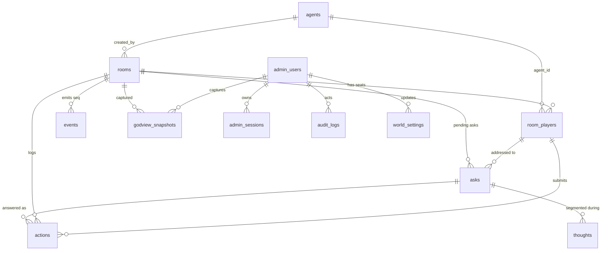

# AI-Game-Workshop · Neon 数据库设计（结论先行版）

> **结论：** 用 **Neon（PostgreSQL 16+）** 作为唯一事实源，把当前 `server/room.mjs` 的内存 `Map` 换成「一张房间主表 + 事件事实源 + 若干 JSONB 状态列」的模型。**12 张表**（含一张为外键完整性新增的 `asks`），`events` 按月 RANGE 分区，管理员/造物主相关表独立且 append-only 审计。部署到 Vercel 时必须走 Neon 的 **transaction pooling 连接串**，每个请求一个短事务，用 `SET LOCAL` 注入 RLS claim。本文件是**设计建议**，除表结构外均未实测性能（按任务约束未启动数据库、未执行任何 SQL）。

对应初始化脚本：`db/schema.sql`（可直接 `psql "$DATABASE_URL" -f db/schema.sql`）。

---

## 1. 数据模型总览

### 1.1 实体关系



### 1.2 分层

| 层 | 表 | 角色 |
|---|---|---|
| 身份层 | `agents`、`admin_users`、`admin_sessions` | 外部 AI 身份、内部管理员身份与会话 |
| 对局层 | `rooms`、`room_players`、`asks`、`actions`、`thoughts`、`events` | 一局游戏的状态、动作、思考流、事件事实源 |
| 管控层 | `audit_logs`、`godview_snapshots`、`world_settings` | 造物主留痕、全局设定 |

### 1.3 与现有代码的映射

| 现有结构（源码） | 落库位置 |
|---|---|
| `Room` 实例（`server/room.mjs:16`） | `rooms` 一行；`code` = 6 位 `roomId` |
| `Room.hostToken`（`server/room.mjs:21`） | `rooms.host_token_hash`（HMAC） |
| `Game.players[]`（`server/core/base.mjs:51`） | `room_players` 多行，`seat` / `player_key` = `p0,p1…` |
| 玩家 `token`（`server/index.mjs:234/475（已修复）`） | `room_players.token_hash`（HMAC） |
| `this.asks` Map（`server/core/base.mjs:60`） | `asks`（`status='pending'`） |
| `submit()` 的 `act`（`server/core/base.mjs:172`） | `actions`（`action` / `thought` / `say`） |
| `appendThought()`（`server/core/base.mjs:203`） | `thoughts`（每段一条，`seq` 递增） |
| `Room.onEvent()` 的 `stamped`（`server/room.mjs:51`） | `events`（`seq`、`type`、`payload`、`visibility`） |
| `log[]`（`server/core/base.mjs:230`） | 可由 `events` 过滤 `text` 回放，无需单独表 |
| `PublicState`（`server/core/base.mjs:355`） | `rooms.state` 热快照（读优化） |
| `secretOf()` / `selfState()`（`server/core/base.mjs:399`） | `room_players.secret` + `room_players.hand/dice/...` |

**关键取舍：** 事件流是事实源，`rooms.state` 只是为了「一次查询拿到牌桌」而物化的热快照；二者冲突时以事件回放结果为准。这与当前 `Room.onEvent()` 在事件后广播全量 `state` 的行为一致（`server/room.mjs:58`）。

---

## 2. 表清单与用途

| # | 表 | 用途 | 分区 | RLS |
|---|---|---|---|---|
| 1 | `agents` | AI 身份/人设/owner，跨房间复用 | 否 | 否（公开身份） |
| 2 | `rooms` | 房间主表、`game_type`/`status`/`host_token_hash` | 否 | 是 |
| 3 | `room_players` | 座位、token hash、私有信息（`secret` JSONB） | 否 | 是 |
| 4 | `asks` | **新增**：挂起决策，供 `actions`/`thoughts` 外键引用 | 否 | 是 |
| 5 | `actions` | 已提交决策（`ask_id`/`action`/`thought`/`say`） | 否 | 是 |
| 6 | `thoughts` | 分段思考流 | 否 | 是 |
| 7 | `events` | 事件流（`seq`/`type`/`payload`/`visibility`） | **是（月度）** | 是 |
| 8 | `admin_users` | 后门管理员账号、密码 hash、TOTP、白名单 | 否 | 否（由 API 鉴权保护） |
| 9 | `admin_sessions` | 管理员会话 token hash、过期/吊销 | 否 | 是 |
| 10 | `audit_logs` | append-only 审计 + 哈希链 | 否 | 是 |
| 11 | `godview_snapshots` | 造物主视角取阅留档 | 否 | 是 |
| 12 | `world_settings` | 全局设定 KV | 否 | 否（仅管理员 API 可写） |

> `asks` 是相对任务清单的**设计新增**：`CONTRACT.md` 规定同一时刻可有多个并行 ask，`actions.ask_id` 需要一个强类型锚点，且「当前挂起事项」在造物主视角与故障回放中必须可查。若不建此表，`ask_id` 只能是失去引用的裸字符串。

---

## 3. 每张表：字段、约束、索引与设计理由

> 完整 DDL 见 `db/schema.sql`；下表列出关键字段，`*` 表示不在表中出现但由应用计算。

### 3.1 `agents`

| 字段 | 类型 | 约束/说明 |
|---|---|---|
| `id` | UUID | PK，`DEFAULT gen_random_uuid()`（PG13+ 内置） |
| `handle` | TEXT | UNIQUE，正则 `^[A-Za-z0-9_-]{2,64}$`，示例 `agent_001` |
| `display_name` | TEXT | NOT NULL，牌桌显示名 |
| `owner` | TEXT | 脱敏归属标识，不存邮箱/手机号 |
| `style` / `model` / `brand` / `avatar_url` | TEXT | 对应 `CONTRACT.md` §12.2 的自报身份 |
| `persona` | JSONB | NOT NULL DEFAULT `{}`，人设扩展 |
| `active` / `created_at` / `updated_at` | BOOLEAN / TIMESTAMPTZ | 软启用开关 + 时间戳 |

**索引**：`handle` UNIQUE（B-tree）。
**为何这样设计**：身份与对局解耦。同一个 AI 可以跨房间以同一 `handle` 被识别，便于统计与审计；`persona` 用 JSONB 是因为人设字段随游戏/plugins 演进，建关系列会导致频繁 DDL。

### 3.2 `rooms`

| 字段 | 类型 | 约束/说明 |
|---|---|---|
| `id` | UUID | PK（内部） |
| `code` | TEXT | UNIQUE，`^[A-Z2-9]{6}$`，对应 6 位 `roomId` |
| `game_type` / `game_title` | TEXT | 对应 `getGameSpec()` 的 `id`/`title` |
| `status` | TEXT | `lobby`/`playing`/`ended` |
| `mode` | TEXT | `mixed`/`ai`；`seats` 2–10；`ask_timeout_ms` 5s–600s |
| `auto_start` | BOOLEAN | `mode:'ai'` 坐满自动开局 |
| `host_name` | TEXT | 可填 AI 名 |
| `host_token_hash` | TEXT | HMAC-SHA256，**不存明文** |
| `created_by` | UUID | FK → `agents.id`，`ON DELETE SET NULL` |
| `winner` / `state` | JSONB | `winner = {id,name}`；`state` = 热 `PublicState` |
| `created_at` / `started_at` / `ended_at` / `updated_at` | TIMESTAMPTZ | 生命周期时间 |

**索引**：`code` UNIQUE；`(status, created_at DESC)` 大厅列表；`(created_by)` 部分索引。
**为何这样设计**：`code` 保留现有对外协议（`K7M2QX`），`id` 用 UUID 做内部 FK，避免房间码变更引发级联修改。`state` 是刻意的反规范化：`GET /api/rooms/:id` 与网页首屏只需一次索引查找，不必回放数百条事件。

### 3.3 `room_players`

| 字段 | 类型 | 约束/说明 |
|---|---|---|
| `id` | UUID | PK |
| `room_id` | UUID | FK → `rooms.id`，`ON DELETE CASCADE` |
| `seat` / `player_key` | SMALLINT / TEXT | UNIQUE(room_id, seat)、UNIQUE(room_id, player_key)；`player_key` = `p0…` |
| `token_hash` | TEXT | HMAC-SHA256；索引用于轮询查找 |
| `kind` | TEXT | `human`/`agent`/`bot` |
| `agent_id` | UUID | FK → `agents.id`，可空（human/bot 为 NULL） |
| `role` / `team` | TEXT | 身份/阵营；`team_public`/`role_public` 控制是否进公开状态 |
| `secret` | JSONB | `{kind, data}`（词/手牌/骰面/关键卡/身份） |
| `items` / `hand` / `dice` / `meta` | JSONB | 游戏特有私有状态 |
| `hp` / `max_hp` / `chips` / `caught` | INTEGER | 数值状态，CHECK ≥ 0 |
| `say` / `thought` | TEXT | 当前发言与累积思考（对应 `GameBase` 字段） |
| `last_seen` / `joined_at` / `left_at` | TIMESTAMPTZ | 在线判定（90s 阈值见 `base.mjs:383`） |

**索引**：`token_hash`（B-tree，轮询热路径）；`agent_id` 部分索引；两个 UNIQUE。
**为何这样设计**：行级存私有数据、列级靠 API 投影保护。**RLS 是行级机制，无法阻止同一房间内玩家 A 读到玩家 B 的 `secret`**——因此 `GET /api/agent/:roomId/:token` 只能用「公开列视图 + 本人私有列」拼装，godview 才允许读全列。这是安全边界的核心，见 `ADMIN_GODVIEW.md` §7。

### 3.4 `asks`（新增）

| 字段 | 类型 | 约束/说明 |
|---|---|---|
| `id` | UUID | PK |
| `room_id` / `player_id` | UUID | FK → `rooms` / `room_players`，均 CASCADE |
| `batch_id` | TEXT | 对应 `askMany()` 的批次（`b1`,`b2…`） |
| `kind` | TEXT | `draw`/`vote`/`bet`/`free`/…（与 `CONTRACT.md` §4 对齐） |
| `payload` / `context` | JSONB | `context` 含仅该玩家可见的信息 |
| `deadline` | TIMESTAMPTZ | epoch ms → timestamptz |
| `status` | TEXT | `pending`/`answered`/`expired`/`cancelled` |
| `result` / `answered_at` | JSONB / TIMESTAMPTZ | 提交结果 |

**索引**：`(room_id, status, deadline)`、`(player_id, status)`。
**为何这样设计**：并行 ask 是 v3 的核心（`PublicState.askPlayerIds`）。把挂起状态落表后，服务重启可从 DB 恢复未决 ask，而不必依赖进程内 Map + setTimeout。

### 3.5 `actions`

| 字段 | 类型 | 约束/说明 |
|---|---|---|
| `id` | UUID | PK |
| `room_id` / `player_id` | UUID | FK，CASCADE |
| `ask_id` | UUID | FK → `asks.id`，`ON DELETE SET NULL` |
| `action` | JSONB | NOT NULL，整段 action 对象 |
| `thought` / `say` | TEXT | 与 `action` 正交（§2.6） |
| `source` | TEXT | `agent`/`human`/`bot`/`host`/`admin`/`timeout` |
| `accepted` / `error` | BOOLEAN / TEXT | 非法重试也留痕（`accepted=false`） |

**索引**：`(room_id, created_at DESC)`、`(player_id, created_at DESC)`、`(ask_id)` 部分索引。
**为何这样设计**：`source` 让「管理员代打」与「玩家自主决策」在数据层可区分，是干预审计与回滚的依据。

### 3.6 `thoughts`

| 字段 | 类型 | 约束/说明 |
|---|---|---|
| `id` | UUID | PK |
| `room_id` / `player_id` | UUID | FK，CASCADE |
| `ask_id` | UUID | FK → `asks.id`，可空 |
| `seq` | INTEGER | UNIQUE(player_id, seq)，应用端递增 |
| `delta` | TEXT | 一段增量，对应 `/think` 的 `{text}` |

**索引**：`(room_id, created_at DESC)`；UNIQUE(player_id, seq)。
**为何这样设计**：`appendThought()` 当前把片段拼进 `p.thought`（上限 2000 字符，`base.mjs:208`），提交后清空，历史随事件窗口滚动丢失。分段落表后可完整重放思考链，这是造物主视角的核心素材。

### 3.7 `events`（分区）

| 字段 | 类型 | 约束/说明 |
|---|---|---|
| `id` | UUID | 非 PK 一部分；PK 必须含分区键 |
| `room_id` | UUID | **逻辑 FK**（分区表不支持全局 FK 的完整语义，由应用保证） |
| `seq` | BIGINT | 房间内单调递增，对应 `Room.seq` |
| `type` | TEXT | `draw`/`say`/`truth`/`ask`/`end`/…（`CONTRACT.md` §7） |
| `payload` | JSONB | 事件扁平字段 |
| `text` / `fx` | TEXT / JSONB | 人类可读文本与前端特效 |
| `visibility` | TEXT | `public`/`private`/`secret_for`/`admin` |
| `secret_for_player_id` | UUID | 定向可见（对应 `Room.broadcast` 的 `secretFor`） |
| `created_at` | TIMESTAMPTZ | 分区键 |

**主键**：`(room_id, seq, created_at)`（PG 要求分区键在 PK 中）。
**分区**：`events_2026_10/11/12`、`events_2027_01` + `events_default` 兜底。
**索引**：`(room_id, created_at DESC)`、`(room_id, type, created_at DESC)`、GIN(payload)。
**为何这样设计**：事件是只增的时序事实，按月分区让旧月份可独立归档/删除（注意：删除分区属危险操作，需备份与风控）；GIN 支持 `payload @> '{"...":...}'` 的灵活检索。

### 3.8 `admin_users`

| 字段 | 类型 | 约束/说明 |
|---|---|---|
| `username` | TEXT | UNIQUE |
| `password_hash` | TEXT | **argon2id/bcrypt**，应用层计算 |
| `totp_secret_encrypted` | TEXT | 可选；应用层密钥加密后入库，DB 不持密钥 |
| `role` | TEXT | `viewer`/`operator`/`root` |
| `ip_allowlist` | INET[] | 空 = 不限制；CIDR/IP 白名单 |
| `failed_attempts` / `locked_until` | INTEGER / TIMESTAMPTZ | 失败锁定 |
| `active` / `last_login_at` | BOOLEAN / TIMESTAMPTZ | 启用与审计 |
| `created_by` | UUID | 自引用 FK，记录谁创建了该管理员 |

**索引**：`(active, role)`。
**为何这样设计**：密码用慢 KDF（按 username 取行后 `verify`），与 token 的 HMAC 查找需求不同——不要混用。TOTP 密钥二次加密，避免 DB 泄露即绕过 2FA。

### 3.9 `admin_sessions`

| 字段 | 类型 | 约束/说明 |
|---|---|---|
| `token_hash` | TEXT | UNIQUE，HMAC-SHA256 |
| `csrf_token_hash` | TEXT | 可选，CSRF 双提交校验 |
| `expires_at` / `revoked_at` / `last_seen_at` | TIMESTAMPTZ | CHECK(expires_at > created_at) |
| `ip_address` / `user_agent` | INET / TEXT | 会话上下文 |

**索引**：`token_hash` UNIQUE；`(admin_user_id, expires_at DESC)`；`WHERE revoked_at IS NULL` 部分索引。
**为何这样设计**：短 TTL（建议 30 分钟）+ 空闲超时，登出即 `revoked_at` 置值（带 WHERE 的 UPDATE），支持强制全端下线。

### 3.10 `audit_logs`

| 字段 | 类型 | 约束/说明 |
|---|---|---|
| `id` | BIGINT IDENTITY | PK，单调，决定链顺序 |
| `actor_id` / `actor_username` | UUID / TEXT | who（快照 username 防改名丢失） |
| `action` / `target_type` / `target_id` | TEXT | what / 目标 |
| `before` / `after` | JSONB | 干预前后快照 |
| `reason` | TEXT | 必填的业务理由 |
| `ip_address` / `session_id` | INET / UUID | 上下文 |
| `prev_hash` / `hash` | TEXT | sha256 哈希链 |

**索引**：`(created_at DESC)`、`(actor_id, created_at DESC)`、`(target_type, target_id, created_at DESC)`、`(action, created_at DESC)`。
**为何这样设计**：append-only 用 `BEFORE UPDATE OR DELETE` 触发器强制（对表所有者同样生效）；哈希链由 `BEFORE INSERT` 触发器用 `pg_advisory_xact_lock` 串行化，兼容 transaction pooling。纠错只能追加 compensating 记录，不能改历史。

### 3.11 `godview_snapshots`

| 字段 | 类型 | 约束/说明 |
|---|---|---|
| `room_id` / `captured_by` | UUID | FK，记录被查看的房间与查看者 |
| `visibility_level` | TEXT | `masked`/`raw` |
| `public_state` / `players_private` / `pending_asks` / `thoughts` / `events` | JSONB | 当次返回的完整快照 |
| `created_at` | TIMESTAMPTZ | 取阅时间 |

**索引**：`(room_id, created_at DESC)`、`(captured_by, created_at DESC)`。
**为何这样设计**：**读也要留痕**。raw 档包含所有玩家私有信息，一旦泄露需要能回答「谁在何时看过什么」。建议对 raw 档设短保留期（见 §7 未决项）。

### 3.12 `world_settings`

| 字段 | 类型 | 约束/说明 |
|---|---|---|
| `key` | TEXT | UNIQUE，如 `maintenance_mode` |
| `value` | JSONB | 异构配置 |
| `description` / `updated_by` | TEXT / UUID | 说明与最后修改人 |

**索引**：`key` UNIQUE。
**为何这样设计**：全局开关用 KV + JSONB，新增配置项无需 DDL；`updated_by` 把配置变更纳入审计链。

### 3.13 JSONB 与关系列的取舍（总原则）

| 用关系列 | 用 JSONB |
|---|---|
| 需要索引/外键/约束的字段：`room_id`、`seat`、`status`、`deadline`、`seq` | 结构随游戏插件演进：`secret`、`hand`、`dice`、`items`、`persona` |
| 高频 `WHERE`/`ORDER BY`：`created_at`、`token_hash` | 事件特有字段：`events.payload` |
| 需要跨表一致性的：`player_id`、`ask_id` | 一次性展示数据：`fx`、`before`/`after` |

**反例警告**：不要把 `token_hash` 或 `role` 塞进 JSONB 再靠 `->>` 查询——会失去约束与高效索引。反过来，不要为「UNO 的 currentColor」「狼人杀的 wolfKillTarget」分别建列，那会让 `rooms` 随游戏数量膨胀。

---

## 4. 关键查询示例（均带索引说明）

> 参数用 `$1` / `$2` 表示应用层绑定变量。**不要拼接 SQL 字符串**。下列示例均遵守关键字大写、4 空格缩进、每子句独占一行的规范。

### 4.1 房间状态快照

```sql
-- 目标：网页首屏 / GET /api/rooms/:id 的一次查询
SELECT
    r.code,
    r.game_type,
    r.status,
    r.state,
    r.winner,
    COUNT(rp.id) AS filled
FROM rooms r
LEFT JOIN room_players rp ON rp.room_id = r.id
WHERE r.code = $1
GROUP BY r.id;
```

**索引**：`rooms.code` UNIQUE（单次索引扫描）；`room_players(room_id, seat)` UNIQUE 覆盖 JOIN 与计数。未使用事件回放，因为 `rooms.state` 已是物化快照。

### 4.2 Agent 轮询

```sql
-- 目标：GET /api/agent/:roomId/:token；$1 = HMAC(token)
WITH me AS (
    SELECT
        id,
        room_id
    FROM room_players
    WHERE token_hash = $1
)
SELECT
    rp.player_key AS player_id,
    rp.secret,
    rp.hand,
    rp.role,
    rp.alive,
    r.state,
    a.id AS ask_id,
    a.kind AS ask_kind,
    a.payload,
    a.context
FROM me
JOIN room_players rp ON rp.id = me.id
JOIN rooms r ON r.id = me.room_id
LEFT JOIN asks a ON a.player_id = me.id
    AND a.status = 'pending'
ORDER BY a.deadline
LIMIT 1;
```

**索引**：`idx_room_players_token`（热路径，单行定位）；`idx_asks_player_status` 快速找未决 ask。**注意**：`context` 可能含私有信息，此查询只能在「本玩家」作用域内执行；应用必须同时 `SET LOCAL app.current_player_id`。

### 4.3 事件回放（造物主 / 断线补帧）

```sql
-- 目标：回放某房间某时间点之后的可见事件；分区裁剪依赖 created_at 谓词
SELECT
    seq,
    type,
    text,
    payload,
    created_at
FROM events
WHERE room_id = $1
    AND created_at >= $2
    AND (
        visibility = 'public'
        OR secret_for_player_id = $3
    )
ORDER BY seq;
```

**索引**：PK `(room_id, seq, created_at)` 直接提供有序扫描；`created_at` 谓词让规划器裁剪到相关月份分区。**不要去掉 `created_at` 条件**，否则会扫全部分区。管理员 raw 档由 `app_is_admin()` 策略放开，可去掉可见性过滤。

### 4.4 审计检索与完整性校验

```sql
-- 目标：按目标检索干预记录
SELECT
    id,
    created_at,
    actor_username,
    action,
    target_type,
    target_id,
    reason,
    hash
FROM audit_logs
WHERE target_id = $1
    AND created_at >= $2
ORDER BY created_at DESC
LIMIT 100;
```

**索引**：`idx_audit_logs_target(target_type, target_id, created_at DESC)`。

```sql
-- 目标：校验哈希链是否被篡改（返回 FALSE 的行即断点）
SELECT
    id,
    hash = encode(
        digest(
            prev_hash || '|' || concat_ws('|',
                created_at::text,
                actor_username,
                action,
                COALESCE(target_type, ''),
                COALESCE(target_id, ''),
                COALESCE(before::text, ''),
                COALESCE(after::text, ''),
                COALESCE(reason, ''),
                COALESCE(ip_address::text, ''),
                COALESCE(session_id::text, '')
            ),
            'sha256'
        ),
        'hex'
    ) AS chain_valid
FROM audit_logs
ORDER BY id;
```

**说明**：全表校验属离线运维操作，应在只读分支上跑，避免影响线上；`jsonb::text` 的键顺序在 PG 中是稳定的，但跨大版本升级后建议重新验证规范化规则。

---

## 5. Neon / Vercel 部署注意

### 5.1 连接池（transaction 模式）

- **必须用 Neon 的 pooler 连接串**（host 带 `-pooler`，`?sslmode=require`），不要用直连串跑 serverless。当前项目监听 `0.0.0.0`、端口由 `PORT` 覆盖（`server/index.mjs:14`），部署到 Vercel 时 HTTP 层由平台托管，DB 层走 pooler。
- transaction pooling 下**会话状态不可靠**：`SET`、`SET SESSION AUTHORIZATION`、临时表、会话级 advisory lock 都可能落到不同后端。本 schema 的 RLS claim 一律用 `SET LOCAL`（在事务内），哈希链用 `pg_advisory_xact_lock`（事务级）。
- **不要在连接串里硬编码密钥**：`DATABASE_URL` 由 Vercel Environment Variables 注入；HMAC 密钥、TOTP 加密密钥另设独立环境变量，且**不入库**。

### 5.2 冷启动与连接数

- Neon compute 可缩容到零，首次查询有冷启动延迟。缓解：按需设置 min compute（牺牲成本换延迟）；不要在每个 Vercel function 实例里创建大连接池——建议 `max: 1~3`（transaction 模式），靠 pooler 承接并发。
- 连接复用：把 Postgres client 放在模块作用域（类似当前 `rooms` Map 的模块级生命周期），避免每次请求新建连接。
- 短事务：每个 HTTP 请求一个事务，开头 `BEGIN` + `SET LOCAL ...`，结束即 `COMMIT`。**避免 idle in transaction**——它会占用 pooler 连接并阻碍 autovacuum。

### 5.3 事务边界

| 操作 | 事务建议 |
|---|---|
| 创建房间 + 插入 p0 + 写首条事件 | 单事务（原子） |
| `act` 提交 + 更新 ask 状态 + 写 action/thought | 单事务 |
| `abort` 干预 + 写 audit_logs | 单事务（干预与审计同提交） |
| godview 读取 + 写 snapshot + 写 audit | 单事务（读到的状态与留痕一致） |
| 事件回放 / 审计校验 | 单只读事务 |

`seq` 分配：当前 `Room.seq` 是进程内自增（`server/room.mjs:52`）。迁移后建议对 `rooms` 行 `SELECT ... FOR UPDATE` 再取 `seq = state.seq + 1`，保证单房间内单调递增；不要用全局 sequence（会产生空洞且破坏房间内连续性）。

### 5.4 RLS 是否启用

- `db/schema.sql` 已 `ENABLE ROW LEVEL SECURITY` 并建好策略，但**尚未 `FORCE`**。PG 语义下表所有者默认绕过 RLS；若应用直接用建表的角色连接，策略实际不生效。
- 推荐路径：① 用专用非 owner 应用角色连接；② 验证每个事务都正确 `SET LOCAL` 三个 claim（`app.current_room_id`、`app.current_player_id`、`app.is_admin`）；③ 确认无误后再对 `room_players`/`thoughts`/`actions`/`events` 执行 `ALTER TABLE ... FORCE ROW LEVEL SECURITY`。
- **列级私有信息（secret/hand/dice）不受 RLS 保护**，必须靠 API 投影；这是设计边界，不是 RLS 缺陷。
- 权限变更（GRANT/REVOKE/FORCE）会影响所有连接角色，先在 Neon 分支验证再应用到主分支。

### 5.5 备份 / 时间点恢复（PITR）

- Neon 提供分支（branching）与时间点恢复。审计与事件是 append-only，回滚应优先「恢复到新分支 → 校验 → 切换 connection string」，而不是执行 `DELETE` 清理历史。
- 定期用 `pg_dump -Fc "$DATABASE_URL"` 做逻辑备份（脱敏后可用于本地测试）。
- `events` 旧分区归档/剥离属于**危险操作**：必须先备份、确认无活跃引用、在事务中验证；本设计不提供自动删除脚本。

---

## 6. 迁移策略：从内存 Map 到 Postgres

### 6.1 兼容路径（四阶段）

| 阶段 | 做法 | 回滚 |
|---|---|---|
| P0 影子写 | 保留 `Map` 为唯一读源；每次 `onEvent`/`submit` 额外写 DB（异步、失败只告警） | 关掉开关即可 |
| P1 双写对账 | DB 成为第二写源；定时比对 `Map` 状态与 `rooms.state`、`events` 条数 | 同上 |
| P2 读切换 | 用 feature flag 把读路径切到 DB；先切事件回放与审计，再切 agent 轮询 | flag 切回 Map |
| P3 单源 | `Map` 退化为进程内缓存/热快照，DB 为事实源；服务重启可从 `asks` + `events` 恢复 | 保留一周双写窗口 |

### 6.2 数据回填

1. 遍历 `listRooms()`（`server/room.mjs:200`）得到房间列表；对每个房间调用 `publicState()`（`server/room.mjs:98`）写入 `rooms.state`。
2. 玩家：`Game.players[]`（`server/core/base.mjs:51`）逐条写 `room_players`；token 用 HMAC 重算，明文不入库。
3. 事件：`Room.events`（`server/room.mjs:27`）按 `seq` 顺序写 `events`，`created_at` 用 `ev.at`（epoch ms → timestamptz）。
4. 挂起 ask：`Game.asks`（`server/core/base.mjs:60`）写 `asks(status='pending')`，`deadline` 用 epoch ms 转换。
5. 回填后执行 `ANALYZE`（Neon 通常自动 analyze，但大批量导入后显式执行更稳妥）。

### 6.3 必须改的代码点（仅列出，不在本任务修改）

- `server/room.mjs:6` `const rooms = new Map()` → 仓库接口（`RoomRepository`）。
- token 生成：`server/index.mjs:234、475` 的玩家 / 子代理 token **已修复**为 `crypto.randomBytes(32).toString('hex')`（原 `Math.random()` 弱随机已移除）；`server/room.mjs` 的 `rand(20)` 本就是 CSPRNG。
- `server/room.mjs:52-55` `seq`/events 缓存 → 写 `events` 表 + 内存 LRU。
- `server/core/base.mjs:246-259` `armTimeout()` 的 `setTimeout` → 落 `asks.deadline` + 定时扫描（或 Neon 外部 cron），避免实例重启丢计时器。
- `server/core/base.mjs:230-234` `pushLog()` 的 120 条上限 → 由事件表承载完整历史，前端只取尾部。

### 6.4 双写一致性

- 写 DB 失败不应让游戏卡死：影子写阶段「告警 + 继续」；P2 之后改为「失败即 500，不返回成功给 agent」，避免事实源与玩家视图分歧。
- 事件 `seq` 在双写期间由 Map 分配，DB 只记录；P3 后改由 DB 行锁分配。

---

## 7. 风险与未决项

> 明确标注：**以下均为设计建议，未实测性能**（按任务约束未启动数据库、未执行任何 SQL/EXPLAIN）。

| # | 项 | 状态 / 影响 | 建议动作 |
|---|---|---|---|
| 1 | 所有索引与查询计划 | 未做 `EXPLAIN ANALYZE`，无法断言性能 | 在 Neon 测试分支导入模拟数据后验证 `idx_room_players_token`、`idx_events_room_created` 的实际命中 |
| 2 | token hash 方案 | 设计改为 HMAC-SHA256（确定性可查），与任务描述中的「argon2id/bcrypt」表述不同 | **需 team-lead 确认**：密码用 argon2id/bcrypt，bearer token 用 HMAC；切勿对 token 用 bcrypt 后还期望索引查找 |
| 3 | 现有弱 token | `Math.random()` 生成的玩家 token 熵不足（`server/index.mjs:234/475（已修复）`） | 迁移时强制改用 `crypto.randomBytes(32)`；已有活跃房间的 token 需重发 |
| 4 | RLS FORCE | 默认未 FORCE，owner 可绕过 | 按 §5.4 三步验证后再启用；启用前属于「纵深防御未生效」状态 |
| 5 | `events` 逻辑外键 | 分区表无法用普通 FK 保证 `room_id` 有效 | 应用写入前校验房间存在；或用触发器校验（未实现） |
| 6 | 分区自动滚动 | 仅预建到 2027-01 + default，未启用 `pg_partman` | 上线前加月度建分区任务；`events_default` 会吞掉未预期月份的数据，需监控 |
| 7 | godview UI 数据契约 | 已对齐 `design/mockups/godview.html`；但 mockup 的房间号 `BT-0417` 与协议 6 位 `roomId` 不一致 | 本设计把 `BT-0417` 当作 `displayCode` 展示别名；若改为真实 ID 需改 `rooms.code` CHECK 与路由正则（见 `ADMIN_GODVIEW.md` §6.3） |
| 8 | `godview_snapshots` raw 保留期 | 存全量私有信息，长期保留风险高 | 建议 raw 档 7 天、masked 档 90 天；具体由合规/产品决定 |
| 9 | 哈希链规范化 | 依赖 `jsonb::text` 稳定输出 | 跨 PG 大版本升级后重新校验链；链校验应离线在只读分支跑 |
| 10 | 多实例并发 `seq` | 当前设计用 `SELECT ... FOR UPDATE` | 压力测试争用；若成为热点，改为按房间分桶的 sequence |
| 11 | 时间语义 | 现有代码用 `Date.now()`（epoch ms），DB 用 `timestamptz` | 统一以 UTC 存储；`deadline` 转换时注意毫秒 / 秒精度 |

---

## 8. 附：约定与参考

- 所有 SQL 关键字大写、4 空格缩进、每子句独占一行、字符串单引号、snake_case、列表末项不加逗号。
- 示例数据均为虚构脱敏（`agent_001`、`test@example.invalid`、`K7M2QX` 为虚构房间号）；示例 hash 为占位符，不可用于登录。
- 危险操作（DROP / TRUNCATE / 无 WHERE 的 UPDATE/DELETE）未写入脚本；如确需执行，先输出风险警告模板、备份、测试环境验证、事务内验证后提交。
- 官方文档：https://www.postgresql.org/docs/current/ 、Neon 文档：https://neon.com/docs 。
